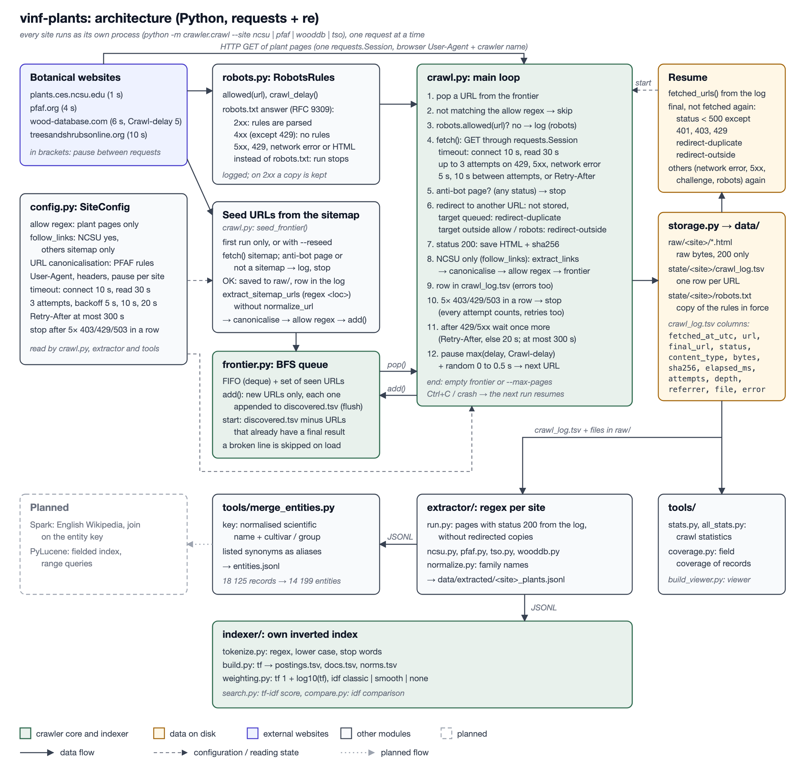

# vinf-plants

Search over trees and ornamental plants by their properties. A course project for
Information Retrieval (VINF) at FIIT STU, 2026/27.

The project crawls plant pages from four botanical websites, extracts plant records with
regular expressions, merges records of the same plant from different sites and searches them
with its own inverted index. A later part joins the data with English Wikipedia (Spark) and
moves the index to PyLucene.

Only `requests` and the Python standard library are used. There is no database, no pandas,
no NLTK, no XPath or DOM-based extraction, no crawling framework and no search library.
`tiktoken` is optional and only used for a token count.

## Sources

| Site | Plant pages | Records | Extracted, for example | Licence of the text |
|---|---|---|---|---|
| [NC State Extension Gardener Plant Toolbox](https://plants.ces.ncsu.edu/) | 4 703 | 4 703 | names, family, height and width, USDA zone, light, soil, description | © NC State University |
| [Plants For A Future](https://pfaf.org/) | 7 172 | 7 151 | authority, synonyms, zone, habit, edibility and medicinal rating, uses, soil, pH | CC BY 4.0 |
| [Trees and Shrubs Online](https://www.treesandshrubsonline.org/) | 5 705 | 5 705 | authority, synonyms, distribution, zone, RHS rating, IUCN status, full article | CC BY-SA 4.0 |
| [The Wood Database](https://www.wood-database.com/) | 589 | 566 | wood density, Janka hardness, strength, shrinkage, IUCN and CITES, uses | all rights reserved |

Pages without a plant (empty pages, wood figure or trade-name pages) are skipped by the
extractors. After merging, the 18 125 records describe 14 199 distinct plants; 163 of them
are on all four sites. The crawled pages (1.33 GB) are not part of this repository. Counted
with `tiktoken` (`cl100k_base`), the raw HTML of the plant pages has 419.3 M tokens and the
text of the extracted records 26.4 M.

## Architecture



## Setup

Step-by-step instructions, including a ready-made index for searching without a crawl, are in
[MANUAL.md](MANUAL.md). Short version with `uv`:

```
uv venv .venv --python 3.12
uv pip install --python .venv/bin/python -r requirements.txt
source .venv/bin/activate
```

## Usage

```
python -m crawler.crawl --site ncsu                  # ncsu | pfaf | tso | wooddb; run again to resume
python -m crawler.crawl --site pfaf --reseed         # read the sitemap again, queue only new URLs
python -m extractor.run --site all                   # one site or all
python -m tools.merge_entities
python -m indexer.build
python -m indexer.search "drought tolerant shrub full sun" --idf smooth --top 10
python -m indexer.compare                            # idf methods side by side
python -m tools.all_stats --tokens                   # crawl statistics of every site
python -m tools.coverage                             # field coverage of the records
python -m tools.pipeline                             # extract, merge, index, compare, coverage in one run
python -m unittest discover -s tests -t .
```

`tools/run_module.py` runs any of these modules from another working directory, for example
from an IDE run configuration.

## Crawler

* Seeds come from each site's sitemap. The frontier is a FIFO queue (breadth-first); every
  new URL is appended to `discovered.tsv` at once, and a set of seen URLs prevents duplicates.
* An allow pattern per site lets only plant pages through. Faceted search URLs on NCSU are a
  crawler trap and are never queued; alias pages under another name are near-duplicates.
* robots.txt is fetched on every run and obeyed; a larger `Crawl-delay` wins. As in RFC 9309,
  4xx means no rules, 5xx, 429 or a network error stops the run, and an HTML page instead of
  robots.txt is treated as an anti-bot page. The file in force is kept in the state folder.
* Requests send a browser User-Agent (Chrome) followed by the crawler's own token
  `VINF-FIIT-STU-crawler/0.1`; robots.txt groups are matched against that token.
* One request at a time per site, pause 1 s (ncsu), 4 s (pfaf), 6 s (wooddb) or 10 s (tso)
  plus up to 0.5 s of random jitter. Each site runs in its own process.
* Timeouts 10 s to connect and 30 s to read. Up to 3 attempts for network errors, 429 and 5xx,
  with backoff or the server's `Retry-After` (at most 5 minutes).
* The crawl stops after 5 blocked answers (403, 429, 503) in a row or at the first anti-bot page.
* Raw response bodies go to `data/raw/<site>/`; one metadata row per request goes to
  `crawl_log.tsv`. State files are append-only and flushed after every line, so an
  interrupted crawl continues where it stopped.

`crawl_log.tsv` columns: `fetched_at_utc, url, final_url, status, content_type, bytes, sha256,
elapsed_ms, attempts, depth, referrer, file, error`.

| status | meaning | fetched again on the next run |
|---|---|---|
| HTTP code, e.g. `200`, `404` | server answer; only `200` is stored | only `401`, `403`, `429` and `5xx` |
| empty | network error after all attempts | yes |
| `challenge` | anti-bot page instead of content | yes |
| `robots` | disallowed by robots.txt, no request made | yes |
| `redirect-duplicate` | redirected to another allowed page, which is stored once under its own URL | no |
| `redirect-outside` | redirected outside the allowed URLs | no |

## Extraction

One module per site in `extractor/`. Patterns are anchored on the labels printed on the page
(`Family:`, `Janka Hardness:`, `USDA Hardiness Zone`) rather than on the position of an
element, so a layout change that keeps the labels does not break them. Where a page has no
label for a region, a single id or class marks the region and the reason is noted in the code.
Values are never guessed: a missing value is `None`.

Every record has the same core fields (`scientific_name`, `authority`, `family`, `genus`,
`common_names`, `synonyms`, `zone_min`, `zone_max`, `height_min_cm`, `height_max_cm`,
`description`, `attributes`) plus fields of its site (ratings, wood properties, conservation
status). Family names typed by hand on the sites ("Roseaceae", "Rosacea") are unified when the
error is in the -aceae ending (`extractor/normalize.py`).

## Merging records

`tools/merge_entities.py` gives every record a key: the lower-cased binomial plus any
qualifier after it (variety, cultivar, cultivar group), with both hybrid spellings unified.
Records with the same key are one plant. A synonym listed on a page joins the page to the
record of that name on another site (e.g. *Feijoa sellowiana* and *Acca sellowiana*); two
different pages of the same site are never merged.

## Index and search

* A document is one record. Its text is the names (each token counted 3×), family, genus,
  description and attribute values; text already present in another field is not counted twice.
* Tokens: regex, lower case, hyphenated words and decimals kept whole, 141 English stop
  words removed, no stemming or lemmatisation.
* The index is built once from all records and stores tf per document (`postings.tsv`), the
  document table and the document vector lengths. idf is computed at query time from df and N,
  so all idf methods share one index.
* Score: document weight `1 + log10(tf)`, document vector normalised to Euclidean length 1;
  query weight `count × idf`; score = sum of products.
* idf methods: `classic` log10(N/df), `smooth` log10(1 + N/df), `none` 1 (baseline).
  Probabilistic idf and BM25 are not used.

Index of all four sites: 18 125 documents, 116 729 terms, 4.35 M postings, 36 MB, built in
about 6 s; a query takes a few milliseconds. The built index is attached to the
[v1.0 release](https://github.com/RikoAppDev/vinf-plants/releases/tag/v1.0), so search runs
without a crawl (see [MANUAL.md](MANUAL.md)).

## Tests

`python -m unittest discover -s tests -t .` runs the unit tests: extractors on saved real
pages with values checked by hand (`tests/fixtures/`, see its README for sources and licences),
the crawler with a fake HTTP session, name normalisation, record merging and the indexer,
including scores computed by hand. There are 242 tests; the Wood Database pages are not
distributed, so 34 of their tests are skipped in a fresh clone.

## Layout

| Path | Content |
|---|---|
| `crawler/` | `crawl.py` loop and CLI, `config.py` per-site rules, `frontier.py`, `links.py`, `robots.py`, `storage.py` |
| `extractor/` | `ncsu.py`, `pfaf.py`, `tso.py`, `wooddb.py`, `normalize.py`, `run.py` |
| `indexer/` | `tokenize.py`, `build.py`, `search.py`, `weighting.py`, `compare.py`, `stopwords_en.txt` |
| `tools/` | statistics, field coverage, record merging, offline HTML viewer of the records |
| `tests/` | unit tests and saved test pages |
| `docs/` | architecture diagram |
| `data/` | crawled pages, crawl state, records and index (created by the commands above, not in git) |
